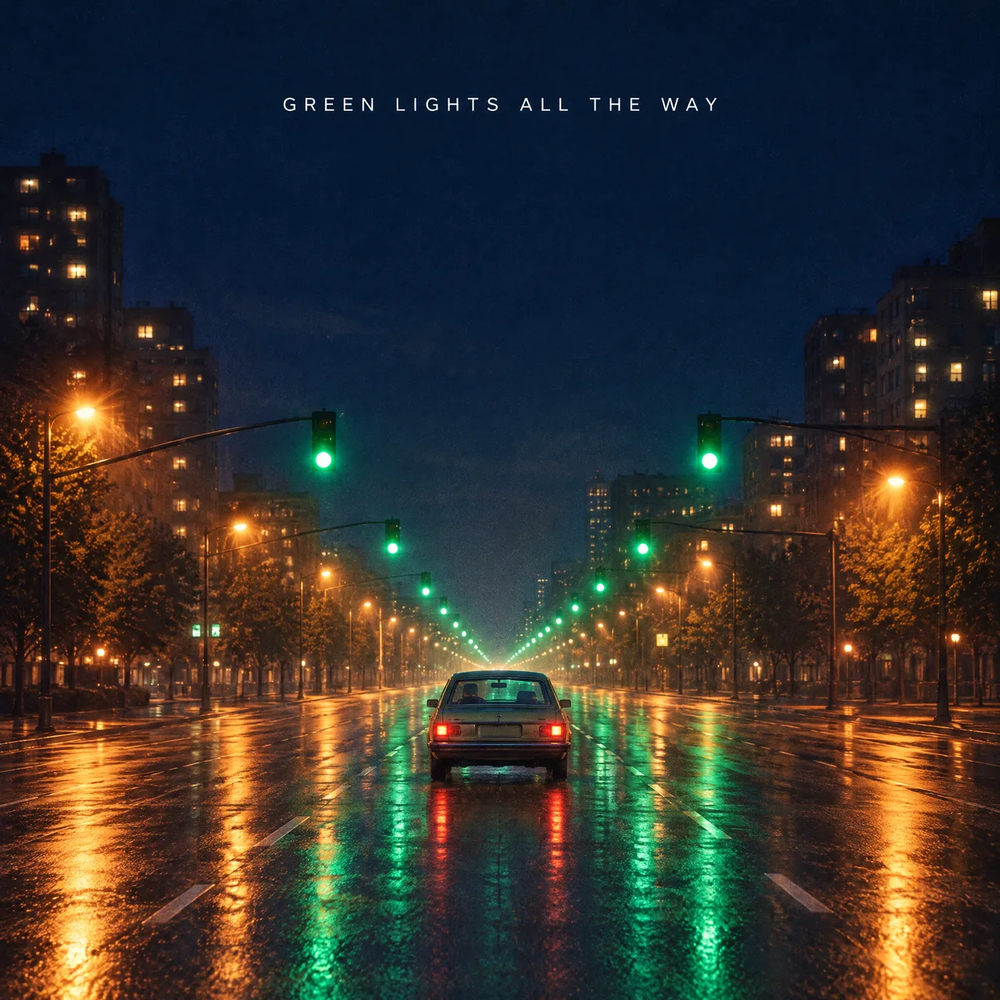

# AI Music Generator Skill

[English](./README.md) | [简体中文](./README.zh-CN.md) | 日本語

> 👉 こちらもどうぞ [Lyrics to Song Skill](https://github.com/beatra-ai/lyrics-to-song-skill)

テーマ、歌詞、参考音源から、楽曲・インスト・サウンドトラックを作成。Claude Code、Cursor、Codex、Windsurf、Cline、OpenClaw のどれからでもそのまま使えます。

> [!IMPORTANT]
> 生成には [Beatra](https://beatra.ai?utm_source=github&utm_medium=flagship&utm_campaign=ai-music-generator-skill) アカウントが必要で、クレジットを消費します。スキル自体のインストールは無料です。

| 項目 | 内容 |
| --- | --- |
| **できること** | テーマ、歌詞、映像、または参考音源から、ジャンル、構成、ボーカルを整理し、試聴できる楽曲、インスト、BGM、動画音楽を制作して重要な点を絞って改善します。 |
| **モデル** | Suno 6、MiniMax Music 3.0 |
| **動作要件** | Python 3.10 以上と、`SKILL.md` を読み込めるエージェント |
| **費用** | インストールは無料。生成のたびに Beatra アカウントのクレジットを消費しますが、課金されるのは、その生成を明示的に依頼したとき、または確認カードを承認したときだけです。 |
| **対応エージェント** | Claude Code、Cursor、Codex、Windsurf、Cline、OpenClaw |

<p align="center"></p>

*深夜に誰もいない街をドライブする曲「Green Lights All the Way」のカバーアート。Beatra AI で生成。*

| Skill | Entry point | Version |
| --- | --- | --- |
| [`music-generation-studio`](skills/music-generation-studio) | [SKILL.md](skills/music-generation-studio/SKILL.md) | 0.2.8 |

このリポジトリは [beatra-ai/beatra-skills](https://github.com/beatra-ai/beatra-skills/tree/main/skills/music-generation-studio) から自動的に公開されています。問題の報告はそちらへお願いします。

## インストール

[`skills`](https://skills.sh) CLI を使う場合：

```bash
npx skills add beatra-ai/ai-music-generator-skill
```

GitHub CLI を使う場合：

```bash
gh skill install beatra-ai/ai-music-generator-skill music-generation-studio
```

または、このリポジトリをクローンして `skills/music-generation-studio` を次の場所にコピーします：Claude Code は `~/.claude/skills/`、Cursor は `~/.cursor/skills/`、Codex は `~/.agents/skills/`、Windsurf は `~/.codeium/windsurf/skills/`、Cline は `~/.cline/skills/`、OpenClaw は `~/.openclaw/skills/`。

または、次の文をエージェントに貼り付けてください：

```text
https://github.com/beatra-ai/ai-music-generator-skill から music-generation-studio スキル（フォルダ skills/music-generation-studio）をインストールし、その SKILL.md に従って私の Beatra アカウントに接続してください。
```

## 作例

<p align="center"></p>

[▶ 試聴する（MP3）](assets/sample.mp3)

*「Green Lights All the Way」の冒頭 60 秒。深夜のドライブというテーマから作詞・制作した、女性ボーカルのインディーポップ。Beatra AI で生成。*

エージェントへの依頼例：

```text
深夜に誰もいない街をドライブする、女性ボーカルの明るい英語インディーポップを作詞・制作して。出だしは静かで落ち着かず、最後のサビで解放感が出るように。
```

プロンプト：

```text
Upbeat English indie-pop single about a late-night drive through an empty city. Arc: restless and quiet at the start, lifting into carefree release by the final chorus. Driving straight eighth-note groove, mid-fast tempo feel. Chorus-pedal electric guitar arpeggios, pulsing analog synth bass, bright vintage polysynth pads, crisp live drums with tambourine on the chorus. Compact conversational verses, rising pre-chorus, wide vowel-led chorus hook, short instrumental synth-guitar break, final chorus gains stacked harmonies, clean ending. Warm, slightly breathy female lead, natural English. Polished modern indie mix, wide stereo, warm tape sheen.
```

## 技術仕様と出力上限

2026-10-18 時点。最新の一覧：https://docs.beatra.ai/ja/docs/models

- **アップロード** — 1 ファイルあたり最大 100 MB。下記の各モデルの入力制限も適用されます
- **テキストから音楽** — 2 モデル（Suno 6、MiniMax Music 3.0）／MP3
  - Suno 6：プロンプトは最大 500、歌詞は最大 5000、タイトルは最大 80 文字
  - MiniMax Music 3.0：プロンプトは最大 2000、歌詞は最大 3500、タイトルは最大 100 文字
- **参照音声から音楽** — 2 モデル（Suno 6、MiniMax Music 3.0）／MP3
  - Suno 6：プロンプトは最大 500、歌詞は最大 5000、タイトルは最大 80 文字／参照音声 6〜480 秒（FLAC、MP3、WAV）
  - MiniMax Music 3.0：プロンプトは最大 300、歌詞は最大 1000、タイトルは最大 100 文字／参照音声 6〜360 秒、最大 50 MB（FLAC、MP3、WAV）

## 得られるもの

- **音楽のアイデア全体を育てる** — 断片から、タイトル、フック、歌詞、構成、ボーカル、アレンジを一貫した楽曲設計にまとめます。
- **用途に合う制作ルートを選ぶ** — ボーカル曲、インスト、BGM、ジングル、動画音楽、多言語曲、参考音源からの新しいアレンジを選べます。
- **最も良い結果を選んで磨く** — 返された全バージョンを聴き、良い点を残し、最も大きな課題を次の制作案で改善します。

## 活用シーン

- **アイデアからオリジナル曲** — 物語、感情、歌詞の断片、フックから、構成と個性が明確なボーカル曲を作ります。
- **歌詞から楽曲** — 用意した完全な歌詞を使うか、歌いやすい歌詞を整えてから、ジャンル、声、アレンジを決めます。
- **動画、キャンペーン、ブランド音楽** — テンポ、感情、会話の余白、終わり方に合わせてBGM、動画音楽、ジングル、ブランド音楽を作ります。
- **ゲーム、ポッドキャスト、プロダクト体験** — 用途に合わせて、テーマ音楽、イントロ、トランジション、雰囲気を支えるインストゥルメンタル・キューを作ります。
- **多言語曲と参考音源を使ったアレンジ** — バイリンガル曲や参考音源からの新アレンジを計画し、生成結果の旋律、声の質感、エネルギー、アレンジを確認します。

## よくある質問

### この音楽生成スタジオでは何を作れますか？

オリジナル曲、インスト、BGM、動画・ゲーム音楽、ジングル、ブランド音楽、ポッドキャストテーマ、多言語曲、参考音源からの新しいアレンジを制作できます。

### 歌詞を書いたり、用意した歌詞を使ったりできますか？

はい。要件から歌いやすい歌詞を作ることも、用意した完成済みの歌詞を使うこともでき、選んだジャンル、感情、構成、歌唱、アレンジの方向に合わせます。

### インスト、ループBGM、目標の長さはどう設計しますか？

目標尺、終わり方、ループ位置、エネルギーの流れ、会話の余白、楽器編成を指定し、生成後に全体を聴いて用途に合うテンポや編集点を整えます。

### Sunoだけを使いますか？

Suno 6が既定です。要件に合う別の利用可能な音楽モデルを明示的に選ぶこともできます。

### 参考音源から新しいアレンジを作れますか？

はい。残したい部分と変えたい部分を決め、生成された旋律、声の質感、エネルギー、楽器、アレンジが方向性に合うか確認します。

## 更新とセキュリティ

2026 年 10 月のリリース以降、このスキルに自動更新機能はありません。インストールしたファイルだけを実行し、
自動的に置き換えることはありません。更新はインストールに使ったツール（`npx skills update music-generation-studio` または
`gh skill update music-generation-studio`）で行ってください。詳細はスキル内の `references/updates-and-security.md` を参照してください。

## ライセンス

[MIT-0](LICENSE)：商用を含め、自由に使用・改変・再配布できます。クレジット表記は不要です。ClawHub 上のこれらのスキルと同じ条件です。

## リンク

- ウェブサイト — https://beatra.ai?utm_source=github&utm_medium=flagship&utm_campaign=ai-music-generator-skill
- ドキュメント — https://docs.beatra.ai?utm_source=github&utm_medium=flagship&utm_campaign=ai-music-generator-skill
- コンソール — https://console.beatra.ai
- AI エージェント向け — https://beatra.ai/llms.txt（インデックス）· https://beatra.ai/llms-full.txt（全スキルを 1 ファイルに）
